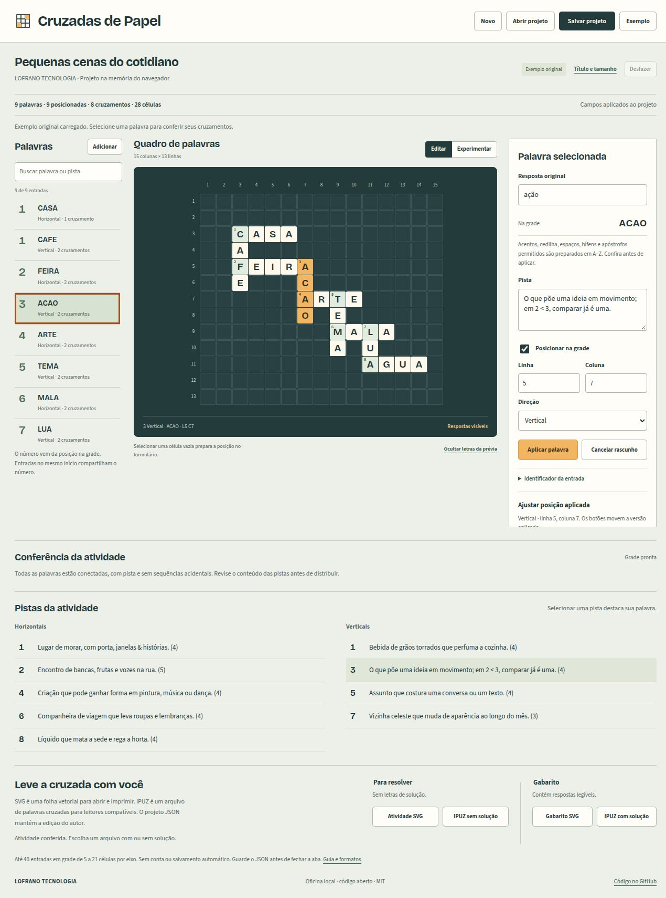

# Cruzadas de Papel

Crie uma cruzada com suas palavras e pistas, ajuste os cruzamentos na grade e baixe uma atividade para resolver e um gabarito. O aplicativo funciona no navegador, em português, e mantém o trabalho na memória da aba. Projeto aberto da [LOFRANO TECNOLOGIA](https://lofranotecnologia.com.br/), com código sob licença MIT.

[Aplicativo web](https://martinlofranodeoliveira.github.io/cruzadas-de-papel/) · [Código e versões](https://github.com/martinlofranodeoliveira/cruzadas-de-papel)



O centro do trabalho é a grade: selecionar uma palavra liga suas células à pista e aos controles de posição. Você pode mover uma célula por vez, girar a direção, retirar uma palavra e procurar outros encaixes. A numeração acompanha as posições atuais, inclusive quando uma horizontal e uma vertical começam juntas.

## Comece pela demonstração

1. Abra a demonstração “Pequenas cenas do cotidiano”. Ela contém nove entradas originais, prontas para exportar.
2. Selecione uma palavra no quadro ou na grade e veja sua resposta original, pista, direção e posição.
3. Experimente uma edição. Antes de aplicar a resposta, confira a prévia em letras A–Z: `café → CAFE`, `ação → ACAO` e `água → AGUA`.
4. Use a busca de encaixes para comparar opções. Uma sugestão só altera a grade quando você a aplica.
5. Resolva as pendências indicadas e abra **Experimentar** para preencher uma tentativa temporária.
6. Baixe o **projeto JSON** para continuar depois. Para distribuir a cruzada, escolha a **atividade** ou o **gabarito**, em SVG ou IPUZ.

A demonstração foi escrita para este repositório e não foi copiada de uma publicação. Seu arranjo tem uma grade de 15 × 13, 9 entradas, 28 células claras e 8 cruzamentos, em um único conjunto conectado. As pistas incluem `&` e `<` como texto. O [mapa completo da demonstração](fixtures/README.md) fixa posições, números, contagens e arquivos canônicos.

## Monte sua própria cruzada

Cadastre a resposta original e escreva uma pista. O aplicativo conserva o original e mostra separadamente as letras usadas na grade. A preparação retira os acentos admitidos, espaços ASCII, hífens e apóstrofos; caracteres incompatíveis geram uma mensagem para revisão. Você decide se aplica a prévia.

Escolha linha, coluna e direção. Na interface, as coordenadas começam em **1**. Letras diferentes no mesmo cruzamento, sobreposição de palavras paralelas ou uma palavra saindo da grade recusam a alteração inteira. Os controles de movimento e direção permitem trabalhar sem arrastar.

Palavras sem pista, sem posição, desconectadas ou encostando de modo a criar uma sequência não cadastrada ficam como pendências. Você pode guardar esse rascunho em JSON. As exportações de atividade e gabarito são liberadas quando todas as entradas têm pista e posição, formam um único conjunto ligado por cruzamentos e correspondem às sequências da grade. Não há exigência de simetria editorial.

**Desfazer** conserva até 30 estados do projeto durante a sessão. A tentativa de resolução também é temporária. Nenhuma dessas funções substitui baixar o JSON antes de fechar ou recarregar a aba.

## Qual arquivo baixar

| Arquivo | Para quê | Contém as respostas? |
| --- | --- | --- |
| `cruzadas-projeto.json` | Guardar e reabrir a edição, mesmo incompleta | Sim, originais e letras canônicas legíveis |
| `cruzadas-atividade.svg` | Folha com grade numerada e todas as pistas | Sem letras de solução na grade |
| `cruzadas-gabarito.svg` | Folha para conferir | Sim, nas células da grade |
| `cruzadas-atividade.ipuz` | Abrir em um consumidor compatível com o perfil descrito | Sem campo de solução ou respostas auxiliares |
| `cruzadas-gabarito.ipuz` | Abrir com solução em um consumidor compatível | Sim, na matriz `solution` |

As pistas e os títulos são escritos por você: se incluírem uma resposta, ela aparecerá na atividade. O modo Experimentar é uma prévia para o autor; o projeto aberto no navegador já conhece as respostas. Para compartilhar com quem vai resolver, escolha os arquivos de atividade e revise os textos.

O SVG é independente, sem fontes ou recursos externos, com texto completo e largura explícita. As pistas usam quebras conservadoras reais e preservam palavras que cabem em uma linha; o ajuste de largura do SVG é apenas uma dica complementar, pois alguns renderizadores o ignoram. A folha tem 1000 unidades de largura e altura calculada até 28000; a aparência das letras pode variar entre sistemas. A entrega atual não gera PDF ou PNG. O IPUZ cobre um perfil específico de cruzadas retangulares bloqueadas com A–Z; a [documentação de formato](docs/FORMATO.md) explica o alcance e os limites de interoperabilidade.

## Limites e dados

- Uma cruzada por projeto; grade de 5 a 21 células em cada eixo; até 40 entradas.
- Respostas de 2 a 21 letras A–Z; uma letra por célula; cruzamentos perpendiculares com letras iguais.
- Título de até 100 pontos Unicode, subtítulo de 160, autoria de 80, resposta original de 80 e pista de 200.
- Projeto JSON de até 512 KiB em UTF-8; importação validada antes de substituir o trabalho atual.
- Sem conta, servidor de aplicação, telemetria ou gravação automática. O conteúdo fica na memória da aba e nos arquivos que você escolhe baixar.

Não há banco de palavras, criação automática de pistas, IA, dicionário ou promessa de encaixe ótimo. [Privacidade e armazenamento](docs/PRIVACIDADE.md) detalha o comportamento local e o que o provedor da página ainda recebe ao servir o site.

## Rode localmente

Requer Node.js 22 ou superior. Python 3 é usado apenas no verificador independente e em suas ferramentas de preparação.

```sh
npm ci --ignore-scripts
npm run build
npm run dev
```

Abra o endereço impresso no terminal. Para verificar o núcleo e criar a distribuição estática:

```sh
npm test
npm run build
```

O build gera a pasta `dist/` com os arquivos estáticos permitidos e um manifesto de hashes.

O aplicativo usa HTML, CSS, módulos JavaScript e APIs nativas do navegador. O consumidor Exolve é uma ferramenta externa de verificação, preparada separadamente por opção explícita; seu player não integra o aplicativo ou sua distribuição.

## Código, verificação e licenças

O núcleo separa regras espaciais (`src/model.mjs`), importação e exportações (`src/io.mjs`) e demonstração (`src/demo.mjs`). Passaram 25 testes Node e 18 testes Python. Os cinco downloads reais também passaram por verificação independente: a atividade IPUZ foi aberta e preenchida no player oficial Exolve no Chrome; o gabarito revelou as nove respostas e 28 células no navegador integrado. O [registro de validação](docs/VALIDACAO.md) descreve o alcance desses ensaios e os limites restantes.

O código original é [MIT](LICENSE). As fontes locais **Bricolage Grotesque** e **Source Sans 3** usam SIL Open Font License 1.1, com os textos completos em [BRICOLAGE-OFL.txt](assets/BRICOLAGE-OFL.txt) e [SOURCE-SANS-OFL.txt](assets/SOURCE-SANS-OFL.txt). O [manifesto de fontes](assets/FONTS.json) registra origem, hashes e ausência de modificações. O SVG usa a família genérica `sans-serif`, sem incorporar essas fontes.

O perfil IPUZ se baseia na [especificação v2 da Puzzazz](https://www.puzzazz.com/ipuz/v2). A verificação externa usa [Exolve](https://github.com/viresh-ratnakar/exolve), MIT, fixado no commit `8f0d4f6dbb82a1b0ff477795aa8f46e9510bfaa2`, sem alterações. A especificação IPUZ e o Exolve são projetos independentes; suas licenças e atribuições permanecem próprias.

Para colaborar, veja [CONTRIBUTING.md](CONTRIBUTING.md). Para comunicar um problema de segurança, veja [SECURITY.md](SECURITY.md).
